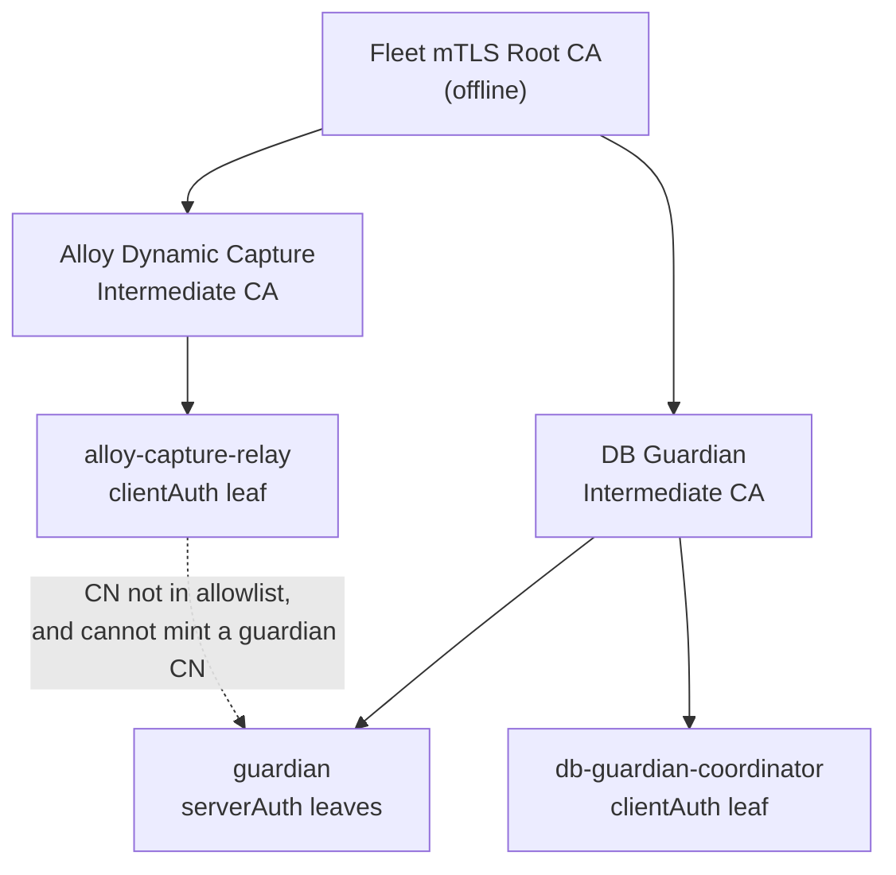
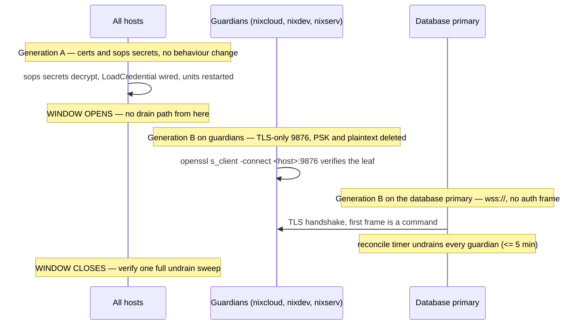

# Design: DB Guardian Mutual TLS

## Context

`db-guardian.service` runs on every host that declares a database dependency — currently `nixcloud`, `nixdev`, and `nixserv` — listening on `0.0.0.0:9876` with no TLS and a single shared PSK, as `root`. The coordinator (`db-database-coordinator.service`, plus its 5-minute reconcile timer) runs on the database primary and dials all three with `ws://`.

The credential it presents is the same on every host, is stored once in `hosts/server/secrets.yaml`, and is sent in clear text every five minutes. The client performs no check on the peer, so the connection authenticates the caller to the server and nothing to the caller. The daemon holds root for the sole purpose of calling `StartUnit`/`StopUnit` on one target.

The repository already has the primitives this needs: a documented offline Fleet mTLS root with one intermediate per service (`docs/src/security/internal_mtls_ca.md`), a server-side TLS pattern in `pkgs/alloy-dynamic-capture/api.py`, a client-side pattern in `pkgs/alloy-dynamic-capture/relay.py`, and a polkit unit rule in `modules/nixos/core/gaming.nix:149`. This design reuses all four rather than inventing new ones.

## Goals / Non-Goals

### Goals

- Every guardian connection is encrypted and mutually authenticated before any JSON is parsed.
- The coordinator verifies it is talking to the guardian it intended to talk to.
- No long-lived shared secret exists in the protocol; identity is a key pair per role.
- The daemon runs unprivileged, with a capability limited to start/stop of `db-databases.target`.
- Availability semantics — drain, undrain, reconciliation, retry — are byte-for-byte unchanged.
- The transport switch is one coordinated generation deployed to every host in a single window, with no half-switched protocol on any host and no transitional listener.

### Non-Goals

- Changing the command vocabulary, the target, or the timer cadence.
- Creating the `nixdb` host or renaming units (owned by `reallocate-server-service-roles`; this change neither waits for nor blocks it).
- Revocation infrastructure (CRL/OCSP); compromise is handled by intermediate rotation.
- Anything outside `db-guardian`: the Alloy CA, its leaves, and its allowlist are untouched.
- Extending the protocol with signed commands or per-message authorization.

## Decisions

### Decision 1: A dedicated DB Guardian intermediate under the existing Fleet root

Add a `DB Guardian Intermediate CA` beneath the offline `Fleet mTLS Root CA`, alongside the SeaweedFS and Alloy Dynamic Capture intermediates.

Trust hierarchy after this change:

```text
Fleet mTLS Root CA (offline, pathlen 1, 10 years)
├── SeaweedFS Intermediate CA (offline, pathlen 0, 5 years)
├── Alloy Dynamic Capture Intermediate CA (offline, pathlen 0, 5 years)
└── DB Guardian Intermediate CA (offline, pathlen 0, 5 years)
    ├── <host> guardian server leaves (serverAuth, 2 years)
    └── db-guardian-coordinator client leaf (clientAuth, 2 years)
```

**Rationale.** The guardian authorises by client common name (Decision 8). Common names are not unique across a CA, so the security of that check depends on *who can mint a certificate carrying the allowed name*. With one intermediate per service, only the holder of the DB Guardian intermediate key can produce `CN=db-guardian-coordinator`. If guardian and monitoring leaves shared the Alloy intermediate, a leaked Alloy intermediate key would be enough to mint a guardian-CN certificate and drive every guardian — the monitoring relay would inherit a capability it must never have.

The root is reused, not replaced, because it is already the fleet's single offline trust anchor, is already distributed to the hosts that need it, and re-deriving a second root would double the offline-key custody problem for no gain. Relying parties continue to trust the root and receive the intermediate in the peer's chain, exactly as `internal_mtls_ca.md` specifies.

**Rejected: reuse the Alloy Dynamic Capture intermediate.** It is the cheapest option — the CA already exists and `allowedClientCommonNames` is already wired. It collapses the monitoring and guardian trust domains, which is the specific thing this change exists to prevent, and it makes the monitoring relay's certificate a guardian credential. Rejected.

**Rejected: a separate new root for the guardian.** Two roots mean two offline keys, two trust bundles on every host, and two rotation procedures. The per-service intermediate already provides the isolation a second root would.

**Rejected: self-signed per-host certificates, pinned by fingerprint.** No CA lifecycle to manage, but every guardian becomes its own trust anchor, so the coordinator needs a per-host pin set, any host addition is a coordinator config change, and rotation has no bulk path. It also removes the EKU signal that distinguishes a client certificate from a server certificate.

### Decision 2: TLS is terminated by the daemon, not a sidecar

`server.py` builds the context itself and passes it to `websockets.serve(..., ssl=context)`, mirroring `api.py:203-209`:

```python
context = ssl.SSLContext(ssl.PROTOCOL_TLS_SERVER)
context.minimum_version = ssl.TLSVersion.TLSv1_2
context.verify_mode = ssl.CERT_REQUIRED
context.load_cert_chain(certfile=..., keyfile=...)
context.load_verify_locations(cafile=...)
```

**Rationale.** A sidecar (`stunnel`, `nginx stream`) would put a second process, a second config format, and a second unit between the network and the daemon, and would have to forward the client's authenticated identity to the daemon anyway — either by header injection, which the daemon must then trust blindly, or by TCP proxy, which discards the client certificate entirely and leaves the allowlist unenforceable. Terminating in-process keeps the peer certificate and the decision in the same place. Both sides already depend on `websockets`, which accepts an `ssl` argument on both `serve()` and `connect()`.

### Decision 3: Per-host server certificates with explicit SANs

Each guardian host gets a `serverAuth` leaf signed by the guardian intermediate, with SANs covering every name by which it may be dialled:

- `<host>` — the bare short name, which is what `--hosts` contains today (`guardian.nix:231`, `guardian.nix:263`)
- `<host>.localdomain` — the configured `networking.domain` (`hosts/server/shared/default.nix:33`)
- `<host>.${server.proxy.domain}` — only on hosts that define that option, for parity with the Alloy leaf profile

**Correction: the third SAN does not exist on the guardian hosts.** `server.proxy.domain` is undefined on `nixcloud`, `nixdev` and `nixserv` (only `nixio` defines `racci.dev`), so a SAN cannot be generated from it there; the issued leaves carry the bare name and `<host>.localdomain`. Nothing in this change dials the proxy name, and the bare name — the one the coordinator uses — is present.

**Rationale.** The client uses `ssl.create_default_context(cafile=…)`, which sets `CERT_REQUIRED` and `check_hostname` and never consults the subject CN. Verification therefore matches against SANs only. The short names in `--hosts` are the ones that must be present; a certificate with only a fully qualified name would be rejected by `check_hostname` before any guardian logic runs.

This also fixes a latent trap: because the client dials hostnames, no IP address appears in the SAN set, and `127.0.0.1` is deliberately excluded (unlike the Alloy leaf, which is also used over loopback). If a future change makes `--hosts` contain addresses, verification breaks loudly rather than degrading.

**Rejected: one wildcard certificate `*.<domain>` shared by all guardians.** Fewer secrets, but a single key compromise forges any guardian, which destroys the property the coordinator verification exists to provide.

### Decision 4: One coordinator identity, not one per target

The coordinator presents a single `clientAuth` leaf with `CN=db-guardian-coordinator`, deployed only to the database primary. Every guardian's allowlist contains exactly `db-guardian-coordinator`.

**Rationale.** The coordinator's capability is identical against every target — it can start or stop one target on each. Per-target client certificates would multiply secrets by the number of guardians, require the coordinator to select a certificate per dialled host, and grant no additional authorization separation, because a coordinator holding all of them can do exactly what a coordinator holding one can do.

Where the per-target distinction *does* buy something is revocation granularity — if the coordinator is ever split so that different database primaries drive different guardian subsets, `nixcloud`'s coordinator should not be able to drive `nixserv`. That is not the topology today. The allowlist is already per-host config, so the extension is additive: add a second CN, issue a second leaf, no protocol change.

**Rejected: per-target client certificates now.** Cost is real (three secrets, three rotations, a per-host certificate map in the client) and the benefit is zero under a single-coordinator topology.

**Rejected: no client certificate, PSK retained over TLS.** Encrypts the wire but keeps a static credential that every host knows, so a compromised guardian can still drive its peers through the coordinator's path, and rotation is still all-hosts-at-once. It also keeps the credential in the JSON frame, which is exactly the thing the change removes.

### Decision 5: Remove the PSK, and cut over in a single window

The PSK is deleted in full. Identity is the client certificate; there is no second factor and no fallback.

The change of transport is not atomic *per host*: a guardian that only speaks TLS cannot be reached by a coordinator that only speaks plaintext. The owner can rebuild every host at the same time, so this is resolved with one coordinated generation rather than a migration ladder:

| Generation | Guardian | Coordinator | Wire |
| --- | --- | --- | --- |
| A. Certificates | unchanged: new sops secrets and `LoadCredential` entries added, nothing reads them | unchanged | plaintext 9876 + PSK |
| B. Cutover | TLS-only on 9876; plaintext listener, `load_psk()`, `--psk-file`, the auth branch and the `authenticated_clients` set deleted | `wss://` on 9876, `load_cert_chain`, no auth frame | TLS 9876, first frame is a `command` |

Generation A is a no-op deploy to every host. Generation B is one module generation, committed once and deployed to every host in a single window: guardians first, database primary last (see "Cost" below). There is no temporary port, no dual-protocol listener, no PSK-required-*and*-TLS mode, and no compatibility shim. A stale client that still sends an auth frame receives `{"type":"error","message":"Unknown message type: auth"}`, which is enough to diagnose version skew in the journal; nothing accommodates it.

**What still has to be ordered, and why.**

1. **Secrets before units (A before B).** A `LoadCredential` pointing at a sops secret that failed to decrypt fails the unit, and `Restart = "always"` turns that into a loop. Generation A exists only so that every certificate exists, decrypts, and has a credential path before any unit references it.
2. **`--psk-file` removal moves with the code that stops requiring it.** In generation A the deployed binary still requires the PSK and the deployed units still pass it. In generation B both sides stop at once: `server.py`/`client.py` stop parsing `--psk-file`, and the units stop passing it and stop loading the credential, in the same commit and the same generation. There must never be a commit in which a unit drops `--psk-file` while the deployed binary still treats it as required — that is a unit that cannot start, or worse, one that starts with no key and fails every connection. The same applies to `LoadCredential`: the `DB_GUARDIAN_PSK` secret is removed from SOPS in the generation whose code stops reading it, and not before, so a rollback of B still has the secret available.
3. **Guardians before the database primary.** See the cost model.

**Cost: drain and undrain are unavailable for the duration of the window.**

From the first guardian switch until the new coordinator completes its first undrain sweep, no drain can be delivered and no undrain can be confirmed. The window is chosen while the database is up and the window itself does not stop it, so this is an exposure to unplanned database loss inside a bounded interval, not planned downtime.

The operator's sequencing, and why it is this way:

- **Guardians first** (`nixcloud`, `nixdev`, `nixserv`), while the database is up. Nothing needs to be drained during a guardian rebuild, only after it, and the coordinate is `undrain`, which the old coordinator no longer can send — so accept that each guardian's undrain attempt fails until the coordinator is switched, and rely on the reconcile timer afterwards.
- **The database primary last.** Its switch restarts the coordinator units and their credentials — `db-database-coordinator.service` and `db-database-coordinator-reconcile.service` — and nothing PostgreSQL's unit reads, so PostgreSQL is not restarted by it. The new coordinator starts on `wss://`, and its first reconcile run undrains every guardian within 5 minutes. Doing the primary first instead would leave the new coordinator facing plaintext guardians for the whole remainder of the window, and a PostgreSQL restart on the primary in that state is a drain that silently does not happen.
- **No PostgreSQL restart on the primary between the first guardian switch and the completed undrain sweep, and that includes the primary's own rebuild.** A planned one is avoidable, and the sequencing above does not require one: the primary's switch changes only the coordinator units and their credentials. The pre-check before the window opens (`nixos-rebuild dry-activate` on the primary, `postgresql.service` absent from the restart list) is what enforces this. An unplanned one is an outage of the dependent services until the sweep succeeds, which is the honest cost of having no fallback path.
- **Abort means finish or revert everywhere.** A single reverted host speaks a protocol no peer speaks, so a partial rollback is a broken fleet. Reverting generation B means restoring the PSK secret and the previous guardian and coordinator generations on all four hosts together.

The window's duration is dominated by the primary's rebuild; the control-plane gap ends one reconcile interval after it. That is the price of deleting the dual listener, and it is the price the owner chose.

**Rejected: a transitional TLS listener on 9877 plus a dual bind (the previous design).** It keeps a live drain path throughout, but it costs a second port in the firewall, a second listener in the daemon, a mode where the guardian requires TLS *and* the PSK, a coordinator that must be pointed at a port it will not keep, and a cleanup step that must not be forgotten — several hundred lines of code and two extra module generations, all of which exist only to be deleted, for a migration that is one maintenance window on a fleet the owner rebuilds together. The sequencing rule above buys the same safety with no code.

**Rejected: same-port protocol sniffing** (peek the first byte, wrap in TLS if it is `0x16 0x03`). Avoids a half-switched fleet without a window, but it puts an unaudited parser in front of the TLS handshake and hands an attacker a downgrade oracle by construction. Rejected on principle, not effort.

**Rejected: keep the PSK as a second factor after mTLS.** Two credentials to rotate, one of which is shared and static. It also keeps `DB_GUARDIAN_PSK` alive in `hosts/server/secrets.yaml`, so the "one secret per host compromise" property is not gained. The PSK is removed rather than retained.

### Decision 6: Non-root daemon, polkit for exactly one target

`db-guardian.service` gains:

```nix
User = "db-guardian";
Group = "db-guardian";
```

backed by a static system user, plus a polkit rule in the module:

```nix
security.polkit.extraConfig = ''
  polkit.addRule(function(action, subject) {
    if (action.id == "org.freedesktop.systemd1.manage-units" &&
        action.lookup("unit") == "db-databases.target" &&
        (action.lookup("verb") == "start" || action.lookup("verb") == "stop") &&
        subject.user == "db-guardian") {
      return polkit.Result.YES;
    }
  });
'';
```

**Rationale.** The daemon's entire privileged surface is two calls: `StartUnit("db-databases.target","replace")` and `StopUnit(...)`, issued by `run_systemctl` through pystemd over the system bus (`server.py:162-196`). Polkit authorises each D-Bus method call individually, and `manage-units` exposes both the unit name and the verb to the rule, so the rule can grant precisely those two operations and nothing else — no restart, no reload, no other unit, no unit-file management. Stopping a target propagates to its dependents inside systemd's job engine, which is not a separate polkit check; the dependents still stop, which is the point of drain.

**Static user, not `DynamicUser`.** Polkit resolves the subject's uid to a user through NSS before evaluating `subject.user`. A transient dynamic user is not reliably NSS-resolvable, so the rule would either fail closed (guardian cannot drain — an availability regression) or need a `subject.uid` rule that cannot be written statically. A static system user with no login shell, no home, and `isSystemUser = true` avoids the whole question and makes the polkit subject stable across restarts. `DynamicUser` is rejected for that reason, not for hardening.

**Fallback if polkit cannot express the rule.** The claim that `action.lookup("unit")` is populated depends on the deployed polkit and systemd versions; `gaming.nix:149` relies on it for `decky-loader.service`, which is evidence but not proof for a `.target`. This must be verified on one guardian before root is removed anywhere — the verification is a task, not an assumption. If the lookup comes back empty or the rule does not fire, the fallback is:

- replace the pystemd call path with `subprocess` invoking `systemctl` (by absolute store path) for the two verbs, and
- grant the same two commands through `security.sudo.extraRules` with `commands = [{ command = "/run/current-system/sw/bin/systemctl"; options = [ "NOPASSWD" ]; }]` narrowed to the exact argument list, or a small root-owned wrapper script that accepts only `start`/`stop` and hardcodes the target.

That fallback is worse — sudoers argument matching is historically brittle and the wrapper is a new privileged component to review — which is why polkit is the primary design and the fallback is only taken after the check fails on hardware. The task list keeps the root removal *after* that check for this reason.

**Read access is not a problem.** Reading `Unit.ActiveState` and `Unit.Upholds` for the state-wait loop (`_wait_for_state`) uses properties that are readable by any local user on the system bus; only the state-changing methods are gated.

### Decision 7: Constant-time comparison is moot; delete it rather than fix it

The `provided_key == psk` comparison at `server.py:253` is timing-unsafe against a 32-character string. After this change there is no key and no comparison: the branch is deleted along with its handler.

**Rationale.** Rewriting it as `hmac.compare_digest` would preserve a control that no longer has anything to protect, and a reader would reasonably conclude a shared secret still exists and still matters. Dead code that looks like a security mechanism is worse than no code. If a shared secret is ever reintroduced — it should not be — the comparison must come back with it, and the spec forbids reintroducing one.

### Decision 8: The allowlist is mandatory and fails closed

`--allowed-cn` is required. `async_main` refuses to construct a listener when the set is empty:

```python
if not allowed_cns:
    logger.error("Refusing to start: no allowed client common names configured")
    return 1
```

A Nix assertion in `guardian.nix` makes the same condition an evaluation error, so a misconfiguration cannot even build:

```nix
assertions = [{
  assertion = cfg.guardian.allowedClientCommonNames != [ ];
  message = "server.database.guardian.allowedClientCommonNames must not be empty";
}];
```

Per connection, the peer certificate is read from the TLS transport and its common name compared against the set; on mismatch the socket is closed with code 1008 before any frame is consumed, and the observed CN is logged.

**How the peer certificate is reached.** The primary hook is `get_extra_info("peercert")` on the connection's transport, mirroring `api.py`. Whether the pinned `websockets` version exposes the *verified* certificate through that call is not assumed: it is the first pre-flight item in the task list, run before any allowlist code is written. If the API does not expose it, the fallback is an `ssl.SSLContext` subclass that records the peer certificate during the handshake (`sni_callback` / `wrap_bio`) and hands it to the connection — the same information, captured one layer lower, still before the first application frame. Either way the decision is made once, up front, rather than discovered while implementing the allowlist.

**Why this is called out.** `pkgs/alloy-dynamic-capture/api.py:88` returns `True` when `allowed_cns` is empty — it fails open. That is a real bug in the pattern this change is otherwise reusing, and copying the surrounding structure without noticing it would reproduce a silent authentication bypass: TLS would still require *a* certificate, but any certificate signed by the root, from any service intermediate, would be accepted. This change does not copy the fail-open branch, and the startup refusal plus the Nix assertion make the empty-set case unrepresentable rather than merely handled. The Alloy bug is out of scope here and should be filed separately.

**Why fail closed at two layers.** The runtime check alone would let a bad generation deploy and then refuse to serve — guardians down, services drained on next reboot. The Nix assertion turns that into a build failure, which is discoverable before activation.

### Decision 9: Ports and firewall

`9876` remains the canonical guardian port and stays in `server.network.openPortsForSubnet.tcp` throughout. No second port is ever opened: the TLS listener replaces the plaintext listener on the same port in the same generation, so the firewall rule and the port number are unchanged by this change and there is no rule to add or remove.

A single port also means a single decision point: a client either completes a TLS 1.2+ handshake with a certificate on that port or is refused, with no other port on which a weaker mode could still be listening.

### Decision 10: Documentation is part of the change

`AGENTS.md` requires docs to move with code. `docs/src/components/db_guardian.md` carries the PSK in four places (lines ~19, 139, 184, 185) and the auth-frame protocol reference; `docs/src/modules/nixos/server/database.md` references the PSK twice (lines ~46, 55). `docs/src/security/internal_mtls_ca.md` gains the guardian intermediate in the hierarchy, the consumer table, and the secret layout. Documentation is updated in the same commit as the behaviour it describes, not in a trailing docs commit. Because the transport cutover is a single generation, there is no intermediate migration state for a doc to describe.

## Alternatives considered

### Tailnet-only transport (WireGuard / Tailscale ACLs), owner rejected

Put the guardians on the tailnet and let WireGuard provide encryption and peer authentication; ACLs decide who may reach port 9876; the PSK goes away as redundant.

Rejected for four reasons:

1. **It authenticates the host, not the process.** Any workload on a tailnet peer that the ACL admits can open the port. The ACL says "the coordinator host may reach the guardians"; it does not say "only the coordinator service may". A compromised process on the coordinator host inherits the capability, and mTLS with a per-service client certificate narrows that to whoever can read `CLIENT_KEY`.
2. **The plaintext path does not disappear.** The listener still binds `0.0.0.0:9876` on the local subnet, so the tailnet is an additional authenticated path over an unauthenticated one. Closing the LAN path would mean binding only the tailnet interface and making `tailscaled` a boot-order dependency of the guardian.
3. **Boot-order coupling.** `db-guardian.service` and `wait-for-db-databases.service` run early in boot. `tailscaled` may not have a usable address at that point, which turns a control-plane dependency into an availability risk for every dependent service.
4. **The ACLs are not in this repository.** They live in the Tailscale admin console, outside review, outside git history, and outside `nix flake check`. The property "a monitoring relay certificate cannot drive the guardian" is enforced by a CA hierarchy that is version-controlled here.

### Keep the PSK as an application-level token over TLS

Rejected: retains a shared static secret, retains rotation-at-once, and adds nothing to identity that the certificate does not already provide.

### Signed commands (HMAC or Ed25519 per message)

Rejected: the transport already authenticates the sender per connection, and the command set is two idempotent operations. Per-message signing would add key distribution and clock/replay handling for no capability change.

### Listener on a Unix socket only

Rejected: the coordinator and the guardians are on different hosts.

## Sequence diagrams

### Handshake and command

```mermaid
sequenceDiagram
    participant C as db-database-coordinator (database primary)
    participant G as db-guardian.service (nixcloud)
    participant P as polkit
    participant S as systemd

    C->>G: TCP connect 9876
    G-->>C: ServerHello + <host> leaf (serverAuth)
    C->>C: verify chain to Fleet root, check_hostname(<host>)
    C->>G: ClientHello + db-guardian-coordinator leaf (clientAuth)
    G->>G: verify chain to Fleet root, EKU clientAuth
    G->>G: CN in allowedClientCommonNames? else close 1008
    C->>G: {"type":"command","action":"drain"}
    G->>P: StopUnit(db-databases.target) over system D-Bus
    P-->>G: YES (unit == db-databases.target, verb == stop)
    S-->>G: job queued; dependents stop
    G-->>C: {"type":"response","action":"drain","status":"ok"}
```

### Trust boundary



### Migration ordering



## Risks / Trade-offs

### Risk: polkit rule does not fire for a target unit

**Problem**: the `action.lookup("unit")` value for a target stop may differ from `db-databases.target`, or the deployed polkit may not expose it, in which case the non-root daemon cannot drain and services stay running through a database shutdown.

**Mitigation**: verify the rule on one guardian with `pkldg`/`journalctl` while issuing a manual drain *before* removing root anywhere. The task list puts this check before the `User=` change for exactly this reason, and Decision 6 states the sudoers fallback rather than assuming polkit works.

### Risk: certificate/secret ordering breaks activation

**Problem**: a unit that references a `LoadCredential` path whose sops secret failed to decrypt fails to start, and `Restart = "always"` turns that into a loop.

**Mitigation**: generation A deploys secrets and credentials only, with no behavioural change, and is verified by checking that each secret decrypts and its credential path exists on each host before generation B is built.

### Risk: SAN mismatch takes the control plane down

**Problem**: `check_hostname` rejects a certificate whose SANs do not contain the dialled name, and the failure looks like a connection error, not a certificate error, if the logging is weak.

**Mitigation**: SANs are generated from `networking.hostName` and `networking.domain` in the same module that builds the `--hosts` argument, so the two cannot drift for the short name; the verification step exercises `openssl s_client -verify_hostname <host>` against each guardian before the coordinator is switched.

### Risk: the cutover window has no drain path

**Problem**: between the first guardian switch and the coordinator's first successful undrain sweep, no drain or undrain can be delivered. A database restart inside that interval leaves dependent services running against a database that is down. Unlike the rest of this change, the exposure is not mitigated by code — it is the deliberate price of rejecting the transitional listener.

**Mitigation**: the window is scheduled with the database up and is short; the sequencing rule in Decision 5 requires the guardians to be switched first and the database primary last; no switch in the window restarts PostgreSQL — the primary's rebuild restarts only `db-database-coordinator.service` and `db-database-coordinator-reconcile.service`, and the `nixos-rebuild dry-activate` pre-check confirms `postgresql.service` is absent from the restart list before the window opens; no PostgreSQL restart is permitted on the primary inside the window, planned or unplanned; and the window is not considered closed until a full undrain sweep has been observed. An aborted window is finished or reverted everywhere, never left mixed.

### Risk: a unit drops `--psk-file` before the binary stops requiring it

**Problem**: if the unit's `--psk-file` argument and credential are removed in a generation whose binary still treats the flag as required, the guardian or coordinator either fails to start or starts without a key and refuses every connection — a silent control-plane outage.

**Mitigation**: the flag, the credential, `load_psk()`, the auth branch and the SOPS secret all change in generation B, in one commit and one generation; generation A passes the flag to a binary that still requires it. The task list ends generation B with a repository-wide check that no `--psk-file` reference remains.

### Risk: coordinator certificate lives on one host and is a high-value target

**Problem**: `CLIENT_KEY` on the database primary authorises stopping every dependent service in the fleet.

**Mitigation**: that is already true of the PSK on the same host, and the certificate narrows it — the key is usable only against guardians, only from a host that can reach them, and only until the intermediate is rotated. File mode is `0400` via `sops-nix` and it is only loaded as a credential into two units.

### Trade-off: single client identity limits per-target revocation

Stated in Decision 4. Accepted under a single-coordinator topology; the allowlist extension path exists if coordinators are ever split.

### Trade-off: no revocation

Consistent with the rest of the internal CA. A leaked guardian leaf stays valid until expiry or intermediate rotation. Accepted; short-lived leaves would be the fix and are out of scope.

### Trade-off: certificate rotation is a manual procedure

`internal_mtls_ca.md` documents the openssl commands; nothing automates renewal. Leaves are 2 years, so this is a documented runbook step, not a gap this change closes.

## Migration Plan

Phases map onto the two generations in Decision 5.

1. **Pre-flight and certificates (generation A).** Pre-flight, no deploy: confirm how the pinned `websockets` version exposes the verified peer certificate (`get_extra_info("peercert")`, or the `SSLContext` subclass fallback) and build every affected host. Then create the guardian intermediate offline; issue `<host>` server leaves for the guardian hosts and one `db-guardian-coordinator` client leaf for the database primary; encrypt each into `hosts/server/<host>/db-guardian-tls/`; add sops declarations, `LoadCredential` entries, and the `db-guardian` user; deploy everywhere. No behaviour change.
2. **Cutover (generation B), one window.** One module generation, committed once: TLS-only listener on 9876 with the allowlist, client context on `wss://`, `--psk-file`/`load_psk()`/auth frame/`DB_GUARDIAN_PSK` removed. Deploy the guardians first (`nixcloud`, `nixdev`, `nixserv`) and the database primary last; verify each guardian with `openssl s_client` as it is switched, then verify the coordinator's first undrain sweep. The window is not closed until that sweep is observed.
3. **Non-root and hardening.** `User=db-guardian` with the polkit rule (or the documented sudoers fallback), then the optional `MemoryDenyWriteExecute`. Separate from the transport cutover so a privilege failure cannot compound with a protocol failure; the polkit verification happens on one guardian before `User=` changes anywhere.
4. **Documentation.** `db_guardian.md`, `database.md`, and `internal_mtls_ca.md`, landing with the generations they describe.

Rollback: generation A is a no-op deploy and can stay in place indefinitely. Generation B is reverted on all four hosts together — restore the `DB_GUARDIAN_PSK` secret from git history, then the previous guardian and coordinator generations — because a single reverted host speaks a protocol its peers no longer do.

## Open Questions

1. **Guardian interface binding.** The listener binds `0.0.0.0` today. Should it bind only the interface the coordinator dials, which would shrink the exposure further? Left unchanged here to keep the change scoped, but it is the natural follow-up once the coordinator reaches the guardians over TLS.

2. **`MemoryDenyWriteExecute`.** Python plus the `pystemd` C extension may or may not tolerate it. It is listed as an optional hardening task rather than a required one, to be kept only if the guardian passes its test suite under it.
